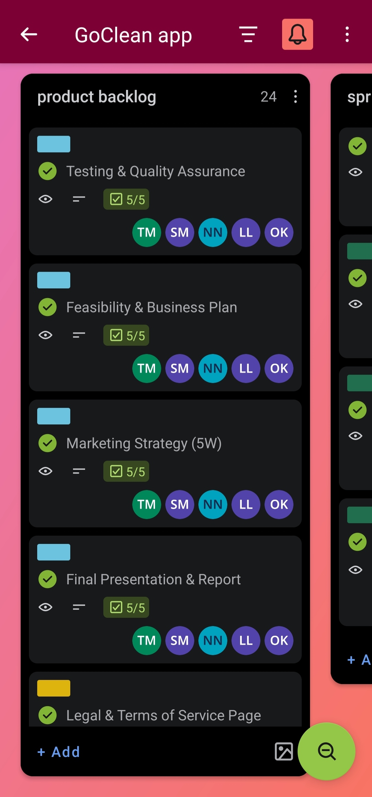
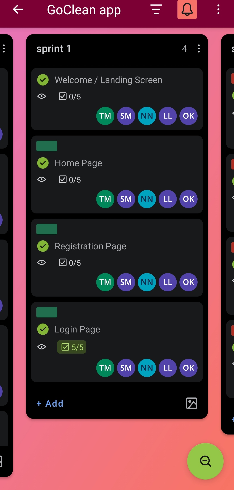
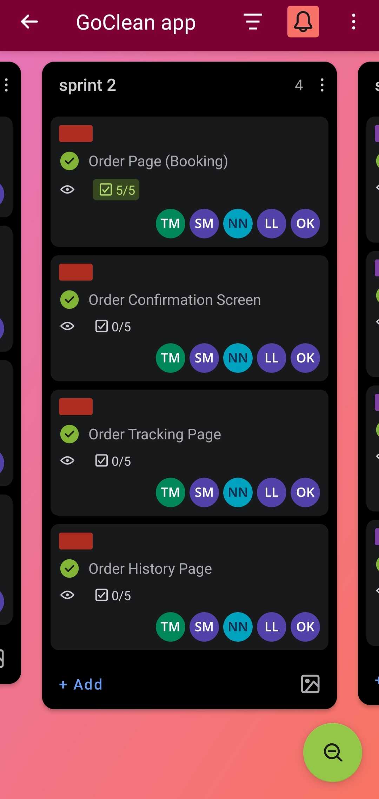
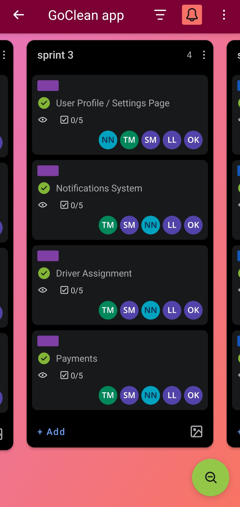
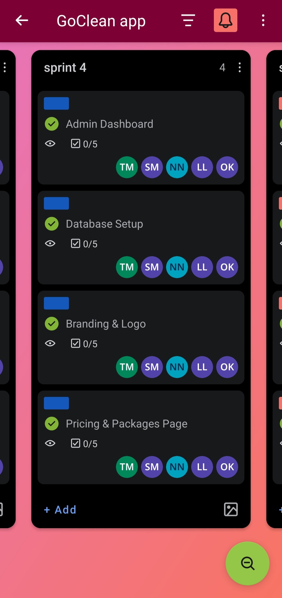
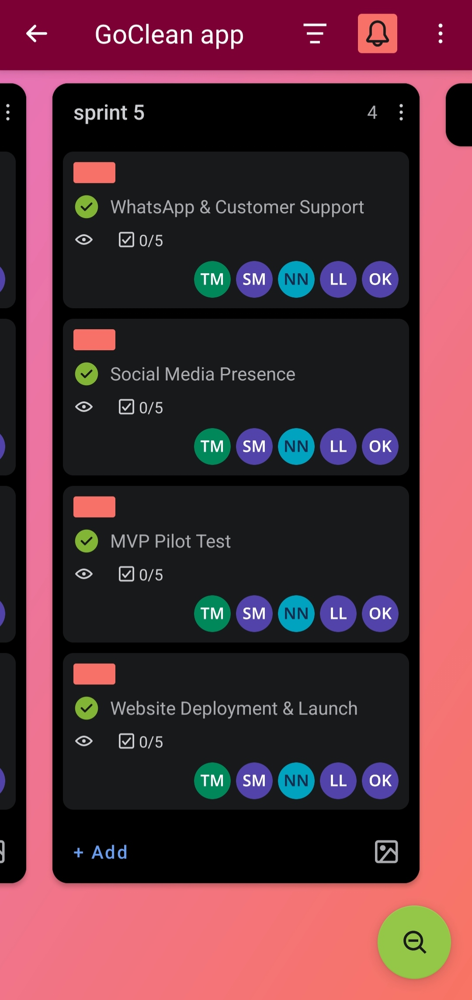

# 👩‍💻 Nomhle Njengele
Aspiring Software Developer | IT Student

---

## 📫 Contact
- **Phone:** 079 714 3173
- **Email:** [216227488@mycput.ac.za](mailto:216227488@mycput.ac.za)
- **Address:** 19 Abramz Katz Ave, Montana, 7490

---

## 🎯 Objectives
I am an ICT student at Cape Peninsula University of Technology (CPUT), studying Application Development. I have a background in Computer Applications Technology (CAT) from high school, which gave me a basic understanding of technology. I am interested in using my programming and problem-solving skills to develop useful applications. I am eager to learn and grow while contributing to a professional development team.

---

## 🎓 Education

**Monwabisi High School** | Matric | 2010 – 2015

**Diploma in Operations Management** | CPUT | 2018 – 2021

**Diploma in ICT: Applications Development** | CPUT | 2024 – Present

---

## 💼 Work Experience
**Zingisani Primary School**
Teacher's Assistant | 2021 – 2022
- Preparing learning materials
- Supporting classroom activities
- Supervising students
- Helping with lesson planning
- Administrative tasks such as filing and record-keeping

---

## 🛠️ Technical Skills
- Java
- HTML & CSS
- Python
- JavaScript

---

## 🚀 Projects

**Personal Profile Website**
- Created a website to showcase my skills and background
- Included clickable links to social media

**Eco Trends App (Group Project)**
- Developed the review section
- Implemented ratings and date features
- Focused on second-hand clothing marketplace functionality

**ATP System (Group Project)**
- Built student registration features
- Developed module management functionality

**Library Management System (Python Group Project)**
- Developed student enrolment functionality
- Applied Object-Oriented Programming (OOP)

---

## 📞 References

**Miss T.C. Mbedla**
Principal | Zingisani Primary School
📧 zingisaneps@telkomsa.net
📱 053 631 3081

**Mrs T.E. Jacobs**
Teacher | Zingisani Primary School
📱 079 498 6391

---

## 🎬 Mock Interview Video
<video controls width="250">
  <source src="interview.mp4" type="video/mp4">
  Your browser does not support the video tag.
</video>

---

## 📝 Reflections

---

### Reflection 1: Coding in Markdown

**Situation:**
For my Project Presentation 3 module (PRP372S) at Cape Peninsula University of Technology, I needed to build a digital portfolio website using GitHub. Before this, I mostly wrote code in Java and Python, so I had very little experience using Markdown language to build web pages.

**Task:**
My goal was to create a neat, professional portfolio page using only Markdown. I needed to use proper headings, bullet points, links, and text formatting so that it looked great when published on GitHub Pages.

**Action:**
I researched how Markdown works on GitHub. I planned out the sections of my website, such as my contact details, education, skills, projects, and my mock interview video. I used headings, bold text, and bullet points to organize the information clearly, and tested my changes regularly.

**Result:**
I successfully built my portfolio using Markdown. I learned that Markdown is very helpful for writing documentation and creating online content, and I feel much more confident using GitHub now.

---

### Reflection 2: Mock Interview Video Experience

**Situation:**
As part of my training, I had to record and upload a mock interview video for a software developer job. Speaking formally on camera was difficult for me because it is very different from writing code or doing school assignments.

**Task:**
My task was to prepare and record a video where I talk about my background, my studies, my programming skills, and my projects with confidence and professionalism.

**Action:**
I wrote down my answers ahead of time. I practiced talking about my experience with Python, Java, JavaScript, HTML, and CSS. I also explained how I helped build the EcoTrend project and how I solve coding problems. When recording, I dressed professionally, used a clean background, and spoke clearly.

**Result:**
This activity helped me improve my communication skills and build my confidence. It taught me how to speak clearly about my strengths and projects, which will help me do well in real job interviews.

---

### Reflection 3: Using GitHub Pages

**Situation:**
Although I had used GitHub before for storing code and school assignments, I had never published a live website using GitHub Pages before.

**Task:**
My task was to set up my GitHub repository correctly so that my portfolio, CV, reflections, and video would display properly on a live website.

**Action:**
I turned on GitHub Pages in my repository settings and chose the correct branch. I tested the website on both my computer and my phone to make sure everything looked good on different screen sizes. When I spotted a mistake, I updated my files, saved the changes, and refreshed the page to check my work.

**Result:**
My portfolio is now live online. This experience taught me an easy way to publish websites and showed me why it is important to test websites on both phones and computers.

---

# 🧼 GoClean Agile Project Management & WIL Reflections
---

## 🌐 Live Web Application & Deployment Reflection
**Evidence:** [GoClean Live Web Application](https://go-clean-one.vercel.app/)

**Reflection:**
- **Situation:** Our GoClean project started as a local Express and MySQL application running only on individual laptops, which limited our ability to showcase a working prototype to stakeholders.
- **Task:** Our team needed to transition the application to a cloud architecture so it could be hosted live and accessed anywhere via a public URL, while ensuring user login functionality worked reliably.
- **Action:** We collaborated to migrate our database to Supabase (PostgreSQL) with Row Level Security, integrated Vercel serverless API functions, set up Resend for real password recovery emails, and deployed the front end on Vercel. I specifically worked on developing the user authentication interface, building the login form flow, and verifying that user credentials log in properly to access application features.
- **Result:** Successfully deploying the application live on Vercel gave us hands-on experience with production-ready cloud deployment, user login validation, serverless backend integration, and full-stack project workflows.

---

## 🤝 Agile Team Charter
**Evidence:** [GoClean Agile Team Charter](Agile_Team_Charter_GoClean.pdf)

**Reflection:**
- **Situation:** Our group of five started working on the GoClean project after our lecturer suggested changing our idea from a clinic booking system to a laundry pickup and delivery service. We needed ground rules on how to work together.
- **Task:** As a developer, I needed to understand my role building the system using Java Spring Boot and help my team agree on our goals and team rules.
- **Action:** Together, we wrote a team charter. We listed our core values, such as respect, clear communication, and teamwork, and decided how we would handle our tasks.
- **Result:** The charter gave every team member a clear job and kept us working well together. I learned that setting team rules early saves a lot of time and confusion later.

---
## 📝 User Stories and Tasks
**Evidence:** [GoClean Trello board](https://trello.com/b/Ia2c4Am0/goclean-app)

**Reflection:**
- **Situation:** On 24 July, we presented our Trello backlog to our lecturer, and she told us our tasks looked like developer chores instead of proper user stories ("As a user, I want to do X so that Y").
- **Task:** My task was to help rewrite our backlog tasks into proper user story format so they focused on what the customer needs.
- **Action:** I wrote out the user stories for our key features—including authentication, order placement, tracking, profile management, and logout flows—and our team updated our Trello board with them before sorting them into sprints.
- **Result:** Writing proper user stories made it much easier to understand what features we needed to build and why our users needed them.

 

<b>Click here to view User Stories & Task Breakdown</b>

 

<h3>Project User Stories & Task Breakdown</h3>
<h4>1. Account Login & Session Access</h4>
<blockquote style="margin-left: 20px; border-left: 4px solid #ccc; padding-left: 10px;">
  <b>As a</b> registered customer, 
  <b>I want to</b> log into my account using my email and password, 
  <b>So that</b> I can securely access my personal dashboard, view my profile, and manage my laundry orders.
</blockquote>
<ul>
  <li><b>As a</b> customer, <b>I want to</b> access a clean and responsive login form, <b>so that</b> I can input my email and password easily.</li>
  <li><b>As a</b> customer, <b>I want to</b> receive real-time validation warnings when entering incorrect email formats, <b>so that</b> I can fix errors before submitting.</li>
  <li><b>As a</b> security-conscious user, <b>I want my</b> credentials verified through secure backend API checks, <b>so that</b> unauthorized users cannot access my account.</li>
  <li><b>As a</b> returning user, <b>I want my</b> session state maintained securely across pages, <b>so that</b> I do not have to log in repeatedly while using the app.</li>
</ul>

<h4>2. Password Recovery & Reset Flow</h4>
<blockquote style="margin-left: 20px; border-left: 4px solid #ccc; padding-left: 10px;">
  <b>As a</b> customer who forgot my password, 
  <b>I want to</b> request a password reset email, 
  <b>So that</b> I can safely regain access to my account.
</blockquote>
<ul>
  <li><b>As a</b> customer who forgot my credentials, <b>I want to</b> request a password reset link, <b>so that</b> I can regain account access safely.</li>
  <li><b>As a</b> user, <b>I want to</b> receive a secure, expiring token via email, <b>so that</b> my password reset attempt is validated safely.</li>
  <li><b>As a</b> customer, <b>I want to</b> set a new password and have it encrypted immediately, <b>so that</b> my account remains protected from unauthorized access.</li>
</ul>

<h4>3. Placing a Laundry Pickup Order</h4>
<blockquote style="margin-left: 20px; border-left: 4px solid #ccc; padding-left: 10px;">
  <b>As a</b> customer, 
  <b>I want to</b> select my laundry service, pickup/delivery dates, and address details, 
  <b>So that</b> the GoClean team can pick up my clothes and fulfill my order.
</blockquote>
<ul>
  <li><b>As a</b> customer, <b>I want to</b> select laundry services, schedule dates, and input my address on a clear order form, <b>so that</b> I can request custom laundry care.</li>
  <li><b>As a</b> customer, <b>I want my</b> submitted orders tied directly to my personal account ID, <b>so that</b> my order details are saved accurately.</li>
  <li><b>As a</b> customer, <b>I want to</b> be redirected to an order summary upon submission, <b>so that</b> I can confirm my booking was successfully received.</li>
</ul>

<h4>4. Order Tracking Page</h4>
<blockquote style="margin-left: 20px; border-left: 4px solid #ccc; padding-left: 10px;">
  <b>As a</b> customer with an active laundry order, 
  <b>I want to</b> track the real-time status and pickup/delivery progress of my laundry, 
  <b>So that</b> I know exactly when to expect my clean clothes.
</blockquote>
<ul>
  <li><b>As a</b> customer, <b>I want to</b> view a visual status timeline of my active orders, <b>so that</b> I know which stage of cleaning or delivery my clothes are in.</li>
  <li><b>As a</b> customer, <b>I want to</b> see real-time timestamp updates on my tracking screen, <b>so that</b> I can plan around driver pickup and delivery times.</li>
</ul>

<h4>5. Order History Page</h4>
<blockquote style="margin-left: 20px; border-left: 4px solid #ccc; padding-left: 10px;">
  <b>As a</b> returning customer, 
  <b>I want to</b> view a history of all my past laundry orders and invoices, 
  <b>So that</b> I can review previous spending and rebook preferred services easily.
</blockquote>
<ul>
  <li><b>As a</b> returning customer, <b>I want to</b> view a complete list of my past completed orders and receipts, <b>so that</b> I can track my overall spending.</li>
  <li><b>As a</b> customer, <b>I want my</b> historical orders retrieved quickly and accurately, <b>so that</b> I can easily reference or repeat past bookings.</li>
</ul>

<h4>6. Editable Profile Management</h4>
<blockquote style="margin-left: 20px; border-left: 4px solid #ccc; padding-left: 10px;">
  <b>As a</b> registered customer, 
  <b>I want to</b> view and update my personal account details and preferences, 
  <b>So that</b> I can keep my contact information and delivery address accurate.
</blockquote>
<ul>
  <li><b>As a</b> customer, <b>I want to</b> edit my phone number, address, and delivery instructions on my profile, <b>so that</b> driver deliveries are always accurate.</li>
  <li><b>As a</b> customer, <b>I want to</b> receive visual confirmation when my changes save successfully, <b>so that</b> I know my updated information is stored.</li>
</ul>

<h4>7. User Sign Out & Session Termination</h4>
<blockquote style="margin-left: 20px; border-left: 4px solid #ccc; padding-left: 10px;">
  <b>As a</b> logged-in customer, 
  <b>I want to</b> log out of my account, 
  <b>So that</b> my session is terminated safely on a shared device.
</blockquote>
<ul>
  <li><b>As a</b> customer, <b>I want an</b> easily accessible "Log Out" button in the menu, <b>so that</b> I can end my session whenever I choose.</li>
  <li><b>As a</b> security-conscious user, <b>I want my</b> active session cleared from browser memory upon logging out, <b>so that</b> others cannot access my account on shared devices.</li>
</ul>

<h4>8. Admin Dashboard</h4>
<blockquote style="margin-left: 20px; border-left: 4px solid #ccc; padding-left: 10px;">
  <b>As a</b> system administrator, 
  <b>I want to</b> view a central management dashboard displaying overall system activity, user statistics, and order volumes, 
  <b>So that</b> I can effectively monitor platform operations and manage service delivery.
</blockquote>
<ul>
  <li><b>As an</b> administrator, <b>I want to</b> view real-time system metrics and driver assignments on a centralized dashboard, <b>so that</b> I can oversee operations smoothly.</li>
  <li><b>As an</b> administrator, <b>I want live</b> updates on order volumes, <b>so that</b> operational bottlenecks can be resolved immediately.</li>
</ul>

<h4>9. WhatsApp & Customer Support Integration</h4>
<blockquote style="margin-left: 20px; border-left: 4px solid #ccc; padding-left: 10px;">
  <b>As a</b> customer needing help with my laundry order, 
  <b>I want to</b> click a quick WhatsApp support button to reach out directly to the team, 
  <b>So that</b> I can get fast, real-time assistance with any questions or issues.
</blockquote>
<ul>
  <li><b>As a</b> customer, <b>I want a</b> floating WhatsApp support button on the web application, <b>so that</b> I can initiate instant live help anytime.</li>
  <li><b>As a</b> mobile customer, <b>I want clicking</b> support to open WhatsApp directly with pre-filled context, <b>so that</b> I can message the support team effortlessly.</li>
</ul>

<h4>10. Website Deployment & Production Launch</h4>
<blockquote style="margin-left: 20px; border-left: 4px solid #ccc; padding-left: 10px;">
  <b>As a</b> project developer and team member, 
  <b>I want to</b> deploy the fully tested GoClean application to the live production environment, 
  <b>So that</b> real customers can access, use, and benefit from the laundry service platform.
</blockquote>
<ul>
  <li><b>As a</b> user, <b>I want to</b> access the application reliably on a secure production URL, <b>so that</b> I can place orders anytime without downtime.</li>
  <li><b>As a</b> customer, <b>I want my</b> data handled safely by live production backend databases, <b>so that</b> my transactions remain seamless and secure.</li>
</ul>

## 📋 Product Backlog
**Evidence:** [GoClean Trello board](https://trello.com/b/Ia2c4Am0/goclean-app)

**Reflection:**
- **Situation:** By late July, our team had a long list of tasks for GoClean including the database, front-end pages, and testing that needed to be organized.
- **Task:** We needed to sort and prioritize our Trello product backlog so we knew what to build first.
- **Action:** As a team, we reviewed our Trello tasks and grouped them into order of importance before submitting our product backlog on 30 July.
- **Result:** Having a clear product backlog kept our work organized and helped us avoid wasting time on the wrong features.

---

## 🏃 Sprint Backlog & Boards
**Evidence:** [GoClean Trello board](https://trello.com/b/Ia2c4Am0/goclean-app)

### Sprint 1 Board

### Sprint 2 Board

### Sprint 3 Board

### Sprint 4 Board

### Sprint 5 Board

**Reflection:**
- **Situation:** After finishing our product backlog, we needed to plan which specific tasks to work on for each sprint.
- **Task:** I helped set up our Trello sprint boards and assigned tasks to different team members.
- **Action:** From 5 to 7 August, I worked with my team to move user stories into our active sprints and assign cards to everyone based on their availability.
- **Result:** By 7 August, our sprint boards were ready, and I could start coding the front-end pages. I learned that sprint boards work best when every task has one clear person in charge.

---

## 📓 Agile Logbook
**Evidence:**
- [14-17 July](Nomhle%20Njengele%20Agile%20Logbook-1.pdf)
- [21-24 July](Nomhle_Njengele_Agile_book_21July_to_24%20July-2.pdf)
- [28-31 July](Nomhle_Njengele_Agile_Logbook_28_31_July_2026-1.pdf)
- [4-7 August](Nomhle_Njengele_Agile_Logbook_4_7_August_06.pdf)

**Reflection:**
- **Situation:** Between 14 July and 7 August, I worked on the GoClean app while trying to meet tight deadlines for my capstone project. Managing my time was my biggest challenge.
- **Task:** I had to record my daily progress, goals, and problems in my Agile logbook.
- **Action:** Every day, I wrote down what I finished such as presentation slides, Figma wireframes, Trello setup, coding the password recovery pages, and setting up sprint boards.
- **Result:** Keeping a daily logbook helped me track my progress and see how I managed my time under pressure. It gave me great hands-on experience with Agile teamwork and time management.

---

## 💻 Portfolio Development & Web Publishing

**Reflection:**
- **Situation:** After finishing all our project work and documents, my final step was to put everything together into a clean digital portfolio using Markdown and GitHub Pages.
- **Task:** My task was to organize the portfolio, format all the sections nicely, and publish the website so my teachers could easily read our work and open our PDF files.
- **Action:** I wrote the Markdown files, added my images and links, and used GitHub to save and publish the updates online.
- **Result:** I successfully published my professional portfolio. I learned how to use Markdown for technical writing and how to use GitHub Pages to share my software projects with the world.
